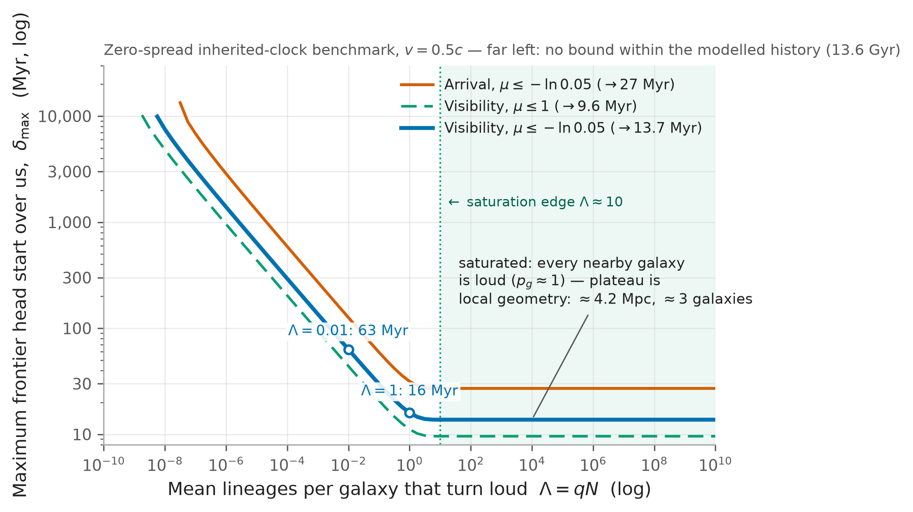
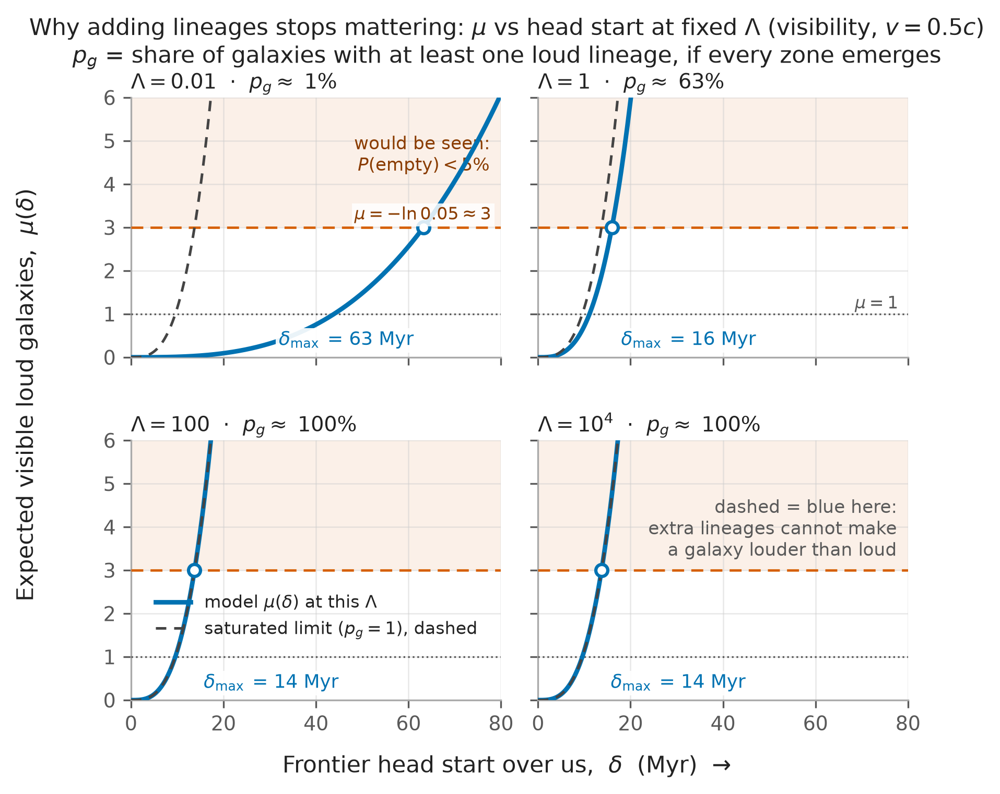

## Abstract

We are close to being able to expand beyond our own planet, and we see nobody else doing it. The hard-steps model explains the silence by making civilisations rare: a chain of improbable transitions on each planet, with earlier expanders closing off territory for everyone else. @Mills2025 have argued that Earth's own record gives poor support for improbable steps, since the candidate transitions may simply have waited for conditions to change. Take that seriously and a problem appears. If lineages usually get there in the end, the older ones had a large head start, and some of those should now be visible. We work out how large that head start is allowed to be. Using flat-space geometry and perfect detection of expanded galaxies, we find that a clock tied to each planet's birth needs the mean number of loud lineages per galaxy, $\Lambda=qN$, held below $\sim2.1\times10^{-8}$. A clock that starts from a shared cosmic event and carries progress between planets faces a looser constraint. With a single shared completion date and $\Lambda$ large enough that most galaxies contain a loud lineage, the permitted lead is about 14 million years. Spreading the start times over a window forces our own start toward the front of that window. Independent, normally distributed lineage durations tighten the constraint further: with a standard deviation of 1% of 13.6 Gyr and $q=1$, about $6\times10^{-12}$ of zones have finished by today, and we sit in the first flush of arrivals inside our own galaxy as well as outside it.

## 1. The observation

Start with something we can see. Humanity is one technological civilisation, arriving at cosmic age $t_0 = 13.8$ Gyr, in a sky with no sign of a civilisation that has spread across its galaxy. Any account of where civilisations come from has to produce that sky, seen from here, now.

The hard-steps account produces it through rarity. A lineage must pass $n$ transitions whose typical waiting times exceed the life of its planet, so the chance of emerging within time $t$ grows as $t^n$ and almost all planets never get there [@Carter1983; @Watson2008; @SnyderBeattie2021]. @Hanson2021 add expansion: the rare lineages that emerge and spread visibly ("grabby" civilisations) occupy volume where later ones can no longer appear independently, so anyone who finds themselves in an empty sky arrived before the local deadline.

@Mills2025 pull in a different direction. Working through the usual candidate steps, they argue that happening once on Earth is weak evidence of improbability. The first lineage to cross a threshold tends to close the niche behind it, and several thresholds coincide with planetary changes (rising oxygen is the standard example) that arrived late for reasons having nothing to do with biological luck. On their reading, Earth's record looks like a sequence of doors opening.

Earth's record, though, is one planet. Suppose the doors do open in sequence and most suitable lineages walk through them eventually. Planets older than Earth started walking sooner. Hanson has put the resulting question to the no-hard-steps position directly [@Hanson2024NoHardSteps], and it is the question this note takes up: how much sooner can the older lineages have finished, given that we see none of them?

The clock we test runs as follows. Progress accumulates in lineages that can move between environments, so a planet's birth starts nothing. All lineages draw on progress from a shared cosmic starting point (our candidate is the first appearance of carbon chemistry) and take a characteristic total time from there. Pieces of this picture are old: @Hanson1998 allowed one difficult beginning followed by steady advance; galaxy-wide synchronisation has its own literature [@Annis1999; @CirkovicVukotic2008]; @SharovGordon2013 argued for a lineage older than Earth. @Ponfilenok2026 works a related model inside one galaxy, with synchrony arising from many small steps; here the bound comes from expansion fronts between galaxies.

We offer no odds on the process clock against hard steps. The calculation assumes the process clock and finds what it costs. The accounts differ in where they put the improbability: inside the transitions, or in the timing.

## 2. Setup

A galaxy today contains $N$ suitable zones. We take $N=10^{10}$ as the central value ($10^{11}$ stars, one in ten assumed suitable) and run the calculation across $10^8$ to $10^{11}$ where it matters. Planet surveys do not fix this number. Zones appear at a steady rate from cosmic age 0.2 Gyr onward; the first belong to small galaxies that later merged into today's. Zones stay present once formed.

Each zone carries one lineage. Two clocks:

- *Planet clock.* A lineage in a zone born at time $b$ **emerges** — reaches the stage at which loud expansion can begin — at $b+T$.
- *Inherited clock.* Progress runs from a shared start $s$. A zone that already exists when the running total reaches $T$ emerges at $s+T$. A zone born at $b<s+T$ joins the process wherever it has got to and also emerges at $s+T$. A zone born at $b>s+T$ is credited with the emerged state on arrival, which makes its emergence time $\max(b,\,s+T)$. Read that formula as bookkeeping for inherited state. The physical picture we have in mind (Section 4) has a late planet seeded with the best material available at seeding, after which the remaining stages still take their time on that planet. The single-clock formula compresses those stages into $T$.

An emerged lineage turns loud (spreads through its galaxy and keeps spreading) with probability $q$. It becomes visible to us later still, after the front has crossed its galaxy and the light has travelled. The front moves at $v=0.5c$. We mostly need one combination:

$$
\Lambda = qN,
$$

the mean number of lineages per galaxy that emerge and turn loud, if every suitable zone emerges. Call it the loud yield. With $m$ emerged lineages in a galaxy, the chance that at least one is loud is $1-(1-q)^m$, close to $1-e^{-qm}$ whenever $q$ is small. $\Lambda$ governs most of what follows; $q$ and $N$ stay separate in the appendix and where the difference matters.

The geometry follows @Olson2018Envelope and @OlsonOrd2021, simplified. Space is flat. Galaxies are scattered independently at an average density of $0.01$ per cubic megaparsec: pick any volume and the galaxy count averages $0.01\times$ volume, with Poisson scatter around it. Two ways for a predecessor to have shown itself:

- *We could see it.* Once a front has crossed its home galaxy (30 kpc across, about 0.2 Myr at $0.5c$), the galaxy counts as visible, and its light needs $r/c$ to reach us from distance $r$.
- *It could be here.* The front itself reaches us after $r/v$.

For each condition separately, count the galaxies expected to satisfy it and call the count $\mu$. Independent galaxies give an empty-sky probability of $e^{-\mu}$. Our working line is $\mu=-\log 0.05\approx3$: beyond it, an empty sky has under a 5% chance *inside this model*. The inputs are assumed, several guessed to an order of magnitude, so each bound below is an edge for those inputs. Giving a bound a probability in the real world would take priors over the inputs and a rule for sampling observers.

Detection here is perfect: every crossed galaxy registers. Existing waste-heat searches look for galaxies re-radiating a large share of their starlight in the mid-infrared, in samples of limited size and depth [@Wright2014G]. Our $\mu$ counts loud galaxies present in the volume. Turning it into a survey probability would need the intercepted starlight fraction, distances, dust and catalogue completeness. Appendix A collects the equations.

## 3. If every planet starts its own clock

This section imposes the opposite rule from the one we favour, to see what it costs. Every zone starts from nothing at its own birth and needs the same time $T$. Earth caps $T$ at 4.6 Gyr for any history run entirely on one planet, and 4.6 Gyr is the choice friendliest to this branch, since a shorter $T$ moves every other planet's finish earlier as well.

Zones have been appearing since 0.2 Gyr, so at $T=4.6$ Gyr every zone born before cosmic age 9.2 Gyr has finished: two thirds of today's stock, with the first finishes 9 Gyr before ours. Holding those finishes to an empty visible sky requires $\Lambda\lesssim2.1\times10^{-8}$. In words: fewer than one galaxy in fifty million may produce a loud lineage, ever, out of its $10^{10}$ suitable zones ($q\lesssim2.1\times10^{-18}$ at the central $N$). Counting only zones old enough to have finished by today, about one galaxy in 73 million hosts an expander now. The arrival condition gives a similar ceiling.

Trust the shape of this result more than its digits. It integrates over gigaparsecs and most of cosmic history, where flat space and a fixed galaxy density are crude. The shape says: planet clocks plus common finishing leave only one place to hide, inside $q$. Almost every finished lineage has to stay quiet, die young, or expand in a way nobody can see. Something has to filter them.

{width=82%}

## 4. A shared starting gun

Now let progress carry between planets, running from the shared start $s$. Planet age stops mattering: what matters is the date $f=s+T$ at which the process first finishes anywhere, and how far that date sits ahead of ours. Write the lead as $\delta=t_0-f$.

Take the extreme case first: every lineage shares the same start and duration, so one frontier date $f$ describes all of them. This case cannot describe our own position (under it we finish at $f$ too, and $\delta=0$). It is the limit the spread-out versions approach, and it shows the geometry cleanly.

For $\Lambda\gtrsim10$ the visibility condition gives $\delta\lesssim13.7$ Myr. Arrival allows 27 Myr; tightening the line to $\mu=1$ gives 9.6 Myr. At $\Lambda=1$ and $0.01$ the leads are 16 and 63 Myr. The plateau is a volume statement: a lead $\delta$ exposes loud galaxies out to about $c\delta$, and at 13.7 Myr that sphere reaches $\sim4$ Mpc and holds about three galaxies. Once those galaxies are loud, more lineages per galaxy change nothing (a galaxy cannot be louder than loud; Figure 3). Cosmic expansion is negligible over 4 Mpc, which is why this number is firmer than Section 3's.

{width=82%}

{width=82%}

Real starts will scatter. Let the start of each galaxy's clock fall somewhere in a window of width $W$, all durations still equal, expansion saturated ($\Lambda$ large). Finishing order then copies starting order. We finished today; the galaxy that started first finished $\delta$ before us, where $\delta$ is exactly our own distance into the window. The sky caps $\delta$, and the cap translates into a position inside the window:

| Window $W$ | Largest $\delta$ | Our start must lie within |
|---:|---:|---|
| 100 Myr | 32 Myr | first 32% |
| 200 Myr | 38 Myr | first 19% |
| 500 Myr | 47 Myr | first 9.5% |
| 5 Gyr | 84 Myr | first 1.7% |

Read the right column as an edge, in the sense of Section 2: start later than it and an empty sky drops below a 5% chance in the model. It is not a probability that we really started inside the edge; that would need priors and an observer rule. Widen the window and the bill arrives as a position nearer its front. Fix our start at the middle of a 5 Gyr window instead, and the bill arrives as $q\lesssim1.4\times10^{-16}$, back in filter territory.

What could fire starting guns across many galaxies within a few hundred Myr? It must reach everywhere and switch on conditions for accumulation. The first stars and their carbon are our candidate [@Bromm2013; @StacyBromm2014]. The sky calculation cannot select it: sliding the start date and adjusting $T$ leaves all finishing dates unchanged. Halo assembly and mixing will widen whatever window the first stars set, so the 100–200 Myr rows are a case to test against enrichment histories.

Picture the two clocks running together. Early stages (chemistry, protocells) are small enough to travel and advance at the pace shared conditions allow. Call the best stage available at a date the frontier. In this picture, Earth's early life records the arrival of material near the contemporary frontier; terrestrial LUCA estimates place a reference point around 4.2 Gyr ago [@Moody2024]. Earth formed shortly before and, on this account, took delivery of frontier material and stayed habitable. Later stages are ecosystems, which do not travel in rocks, so the last 4.2 Gyr runs separately on each receiving planet. Delivery rates are themselves uncertain and may be low [@AdamsNapier2022]. The picture needs the early, portable stages to be the slow ones; the scatter in the later stages also matters, as the next section shows.

From a start at cosmic age 0.2 Gyr, our elapsed duration is 13.6 Gyr: the start choice read back to us. The next section moves the *typical* duration off that value.

## 5. Variation in duration

So far every lineage in a galaxy has shared one start and one duration. Split the two:

$$
C_{i,g}=S_g+D_i,
$$

with $S_g$ a start shared across galaxy $g$ and $D_i$ the duration of lineage $i$. Section 4 priced scatter in $S_g$. A galaxy goes loud through its earliest loud lineage. How much earlier that happens depends on how independently its lineages develop. Shared ancestry and exchange of material can correlate their progress; we compare a single duration shared across a galaxy with independent durations for every zone.

First hold durations shared, one draw per galaxy, and vary the shape of the draw. At a standard deviation of 1% of 13.6 Gyr, bounded (uniform) durations allow 3.9–6.0% of galaxies to have emerged by today; a smooth normal tail allows about 0.5%. A lineage ahead of us by $\tau$ can be seen across a volume growing as $\tau^3$, so the fast tail carries outsized weight.

At the opposite limit from a shared duration, give each lineage an independent duration, normally distributed with spread $\sigma_T$. This tests how much the constraint tightens when a galaxy contains many separate opportunities to finish early. @Hair2011 spread emergence times normally for up to $10^4$ civilisations and stressed the first one's long head start, placing the centre of his distribution near today. Invert it: the first emergences arrive around now, so where does the centre sit? The fastest of $10^{10}$ draws lands about $6.4\sigma_T$ ahead of the mean. Holding the mean at or before today and using the 14 Myr plateau as a rough allowance for the lead gives $\sigma_T\lesssim2$ Myr: durations equal to one part in $10^4$. Local chemistry, waits for planetary conditions and sterilising accidents will not hold that line over 13.6 Gyr.

Take a spread of hundreds of Myr and solve for the mean that keeps the sky empty, building each galaxy's loud probability from its $10^{10}$ draws. Then check home. The setup so far counted other galaxies; inside the Milky Way the expected loud lineages ahead of us are $\Lambda F(t_0)$, where $F$ is our emergence percentile, and our chance of being first loud at home is $e^{-\Lambda F(t_0)}$. (Fronts cross the galaxy in under a million years, so travel time barely moves these rows.) At $q=1$:

| Duration spread $\sigma_T$ | Share of zones emerged by today, $F(t_0)$ | Expected loud lineages ahead of us in the Milky Way |
|---:|---:|---:|
| 30 Myr | $5.9\times10^{-10}$ | 5.9 |
| 136 Myr (1% of 13.6 Gyr) | $6.2\times10^{-12}$ | 0.06 |
| 408 Myr (3%) | $2.7\times10^{-13}$ | 0.003 |

These rows assume independent normal durations (Appendix A); tail shape and correlations between lineages change them. Correlation leaves the expected count $\Lambda F(t_0)$ unchanged at a fixed marginal percentile, but changes the probability that no lineage has yet turned loud. Two points. First, we sit far out in the tail: at the 1% spread, among the first $\sim10^{-11}$ of zones to emerge, with the typical zone emerging 0.9 Gyr from now. Second, one tail position covers home and away. At spreads of 100 Myr and up, external galaxies bind harder than ours — many galaxies, each with $10^{10}$ draws, the nearer ones dominating $\mu$ by count — and a position deep enough for them leaves 0.06 expected loud lineages ahead of us at home. At 30 Myr the home condition binds instead, at $F(t_0)\sim10^{-10}$. Either way the picture is a first flush: a thin leading edge arriving around now in galaxy after galaxy, the bulk behind it. Eventual emergence can still be the rule; the sky charges for it in percentile rather than in $q$.

We have not converted that percentile into a probability for our existence. Observers only ever sample emerged lineages in unoccupied territory, and modelling that sampling (with the occupation of our own galaxy handled explicitly) belongs to a longer treatment. The comparison to keep is like-for-like: $F(t_0)$ is the share of zones emerged by today, the same units as a hard-steps success share per zone.

## 6. Conclusions

The process clock itself is the largest thing left out: we assume a characteristic duration and inherited progress, and derive neither from chemistry. Also assumed: an emerged lineage that turns loud stays recognisable once it has crossed its galaxy; zones accumulate smoothly and are never destroyed; each zone's lineage either runs the full course or contributes nothing.

For the 14 Myr cap only the nearest few megaparsecs enter, and there flat, unclustered galaxies are a fair first pass — though the actual Local Group arrangement would shift the cap by factors of order unity. Section 3 uses the same flat machinery over cosmological distances and should be read as a scaling statement until redone in an expanding universe with an evolving galaxy population. Clustering also correlates neighbours' enrichment histories and hence their start times.

Our galaxy enters Section 5 through the expected count of earlier loud lineages and the probability of none under independent durations. A full treatment needs positions within the galaxy, and the selection effect that independent civilisations only report from unoccupied space. Those ingredients would also turn emergence percentiles into observer probabilities. They are deferred, with any attempt to derive durations from accumulated opportunity.

To summarise the account: planet-bound clocks, with each planet running its own abiogenesis and long evolution from scratch, make the sky empty by making loud lineages vanishingly rare per galaxy. That is the pressure that pushes the explanation toward intrinsic hard steps. A shared cosmic start with inherited progress makes the sky empty a different way. With a single shared completion date and appreciable loud yields, the permitted lead is about 14 Myr. Spreading the starts permits a longer lead, but still places us in the first flush of arrivals on cosmological timescales. With independent, normally distributed durations and $q=1$, the examples place us among the first roughly $10^{-10}$ to $10^{-13}$ of zones to emerge, with the mean emergence still to come. Correlated histories change these percentiles; the shared-duration calculation shows how much weaker the constraint can become. In the independent normal-duration model with a 1% spread and $q=1$, the fitted timing leaves an expected 0.06 earlier loud lineages in the Milky Way, giving about a 94% chance of no earlier loud lineage in our galaxy. On that branch the first flush is local as well as global. Nothing here shows the process clock is true. It shows the clock can be run without a filter, and states the timing it then requires.

## Data and code availability

Configurations, saved outputs and verification files sit in the accompanying repository. `make baseline`, `make inference`, `make start-spread` and `make duration-spread` regenerate the sweep numbers; `uv run python -m lineage_cap.iid_tail` regenerates the normal-tail table at `results/iid_tail/normal_tail_estimate.csv`. `make check` runs the tests.

## References

::: {#refs}
:::

## Appendix A. Calculation {.appendix}

Times are cosmic ages in Gyr; distances are Mpc; $c=306.6014\ \mathrm{Mpc\,Gyr}^{-1}$. Zone counts grow as
$$
N(t)=N_0\,\operatorname{clip}\!\left(\frac{t-s}{t_0-s},0,1\right)^\alpha,
$$
with $s=0.2$ Gyr, $\alpha=1$, $N_0=10^{10}$ at the centre of a $10^8$–$10^{11}$ sweep. Finished counts by deadline $t$ under the two clocks:
$$
m_{\rm planet}(t;T)=N(t-T),\qquad
m_{\rm inherited}(t;f)=\mathbf 1_{t\ge f}N(t),
$$
where $f=s+T=t_0-\delta$. A galaxy with $m$ finished lineages hosts a loud one with probability
$$
p_g(t)=1-(1-q)^{m(t)},
$$
evaluated as $-\operatorname{expm1}[m\log1p(-q)]$. Visibility and arrival impose deadlines
$$
t_{\rm vis}(r)=t_0-D/v-r/c,
\qquad
t_{\rm arr}(r)=t_0-r/v,
$$
with $D=0.03$ Mpc and launch delay set to zero. Writing a deadline as $t_k=t_0-d_k-r/c_k$,
$$
\mu_k=4\pi n_g\int_0^{R_k}r^2p_g[t_k(r)]\,dr,
\qquad
P(\mathrm{empty})=e^{-\mu_k}.
$$
The working line is $\mu_k=-\log(0.05)$. When every galaxy in reach is loud, $p_g=1$ inside the integral and
$$
\delta_{\max}=d_k+\left(\frac{3\mu_k}{4\pi n_gc_k^3}\right)^{1/3},
$$
which is the 13.7 Myr plateau: $d_{\rm vis}=D/v\approx0.2$ Myr plus the light-travel radius that encloses an average of three galaxies.

For starts spread uniformly over width $W$ with one draw $S=s_{\rm first}+U$ per galaxy and a common duration, the share of galaxies finished by $t$ is
$$
F(t)=\operatorname{clip}\!\left(\frac{t-t_0+\delta}{W},0,1\right),
$$
and averaging over the start draw comes before the at-least-one step: $p_g=F[1-(1-q)^{N(t)}]$. With $H$ independent start groups per galaxy, $p_g=1-\{1-F[1-(1-q)^{N(t)/H}]\}^{H}$. The galaxy-shared duration sensitivities in Section 5 convolve this start window with uniform or normal durations, one draw per galaxy, in the saturated limit.

The per-lineage estimates in Section 5 use a single shared start $S$ for all galaxies and durations $D\sim\mathcal N(m,\sigma_T^2)$ drawn independently per zone. Writing $F_D$ for the duration CDF, the emerged share by $t$ is $F(t)=F_D(t-S)$ and a galaxy is loud by deadline $t$ with probability
$$
p_g(t)=1-\left[1-qF(t)\right]^{N(t)}.
$$
Inserting this in the visibility integral and solving $\mu_{\rm vis}=-\log(0.05)$ for $m$ at fixed $\sigma_T$ gives the emerged shares $F(t_0)$ tabulated in Section 5 ($q=1$, $N(t_0)=10^{10}$). The Milky Way column is $qN(t_0)F(t_0)$, the mean count of loud lineages by $t_0$ in one galaxy; the probability that a named lineage emerging at $t_0$ is the first loud one in its galaxy is $\exp[-qN(t_0)F(t_0)]$ to Poisson accuracy, with travel-time corrections across the galaxy below 1% at these spreads. Quadrature over lookback time with the normal CDF reproduces the table; values are saved in `results/iid_tail/normal_tail_estimate.csv`. Tail shape matters at the order-of-magnitude level and these rows should be read as normal-tail arithmetic.

Sweep integrals use Gauss–Legendre quadrature with a change of variables that resolves the thin partly-loud shell at the edge of the visible volume; inversions use bisection. Doubling the quadrature order shifts saved boundaries by at most $1.4\times10^{-7}$ (500 baseline boundaries) and $1.1\times10^{-7}$ (600 start-window boundaries, 60 probability ceilings) in relative terms. Those figures describe the arithmetic. The scenario choices are uncertain by far more.

